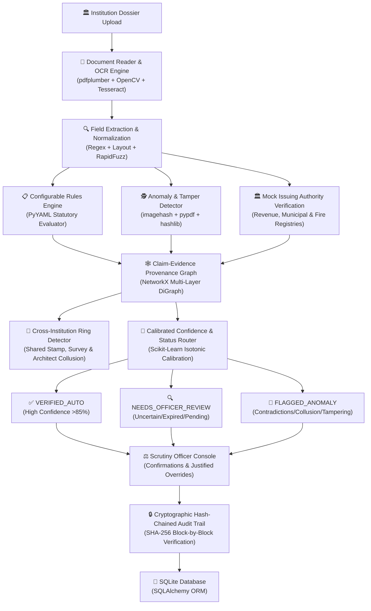

# 🛡️ Sakshya: AI-Powered Application Validation, Document Authentication & Regulatory Compliance for AICTE

**Smart India Hackathon 2026 (SIH 2026)**  
**Problem Statement SIH26261:** AI-powered application validation, document authentication, and regulatory compliance verification for AICTE.

---

## 🌟 Executive Summary

**Sakshya** is an end-to-end regulatory scrutiny intelligence platform built for the **All India Council for Technical Education (AICTE)**. It transitions statutory institutional approval scrutiny from manual, error-prone checklist inspections to an **automated, multi-source evidentiary pipeline** powered by computer vision, OCR, claim-evidence knowledge graphs, cross-institution ring collusion detection, calibrated confidence routing, and tamper-evident cryptographic audit logs.

---

## 🏗️ Technology Stack

| Layer | Technology | Function in Sakshya |
|---|---|---|
| **Language** | Python 3.11+ | Core runtime environment |
| **Dashboard** | Streamlit, pandas, Plotly, pyvis | Interactive officer console, graphs, and audit ledger |
| **API** | FastAPI, Pydantic, Uvicorn | High-throughput REST API & mock issuer verification |
| **PDF Reading** | pdfplumber | Native PDF layout, tabular data, and text coordinate extraction |
| **OCR & Vision** | Tesseract (pytesseract), OpenCV (cv2) | Image denoising, adaptive thresholding, Hindi/English OCR |
| **Data Generation** | Pillow, ReportLab, Faker | Synthetic legal deeds, building sanctions, stamps, and QR codes |
| **Field Extraction** | Regex, Layout rules, RapidFuzz | Fuzzy entity matching, statutory number and date normalization |
| **Rules Engine** | PyYAML, Custom Rule Evaluator | Configurable Approval Process Handbook (APH) compliance checks |
| **Anomaly Detection** | hashlib, imagehash, pypdf, Date logic | Digital metadata forensics, font tampering, stamp hash reuse |
| **Knowledge Graph** | NetworkX | Provenance directed graph linking claims, documents, and rules |
| **Confidence Routing** | scikit-learn (Isotonic Regression) | Calibrated routing (Auto-Verified, Officer Review, Anomaly) |
| **Authority Verifier** | FastAPI Mock Service, pyzbar | 6-state issuing authority simulation & QR payload validation |
| **Database & Audit** | SQLite, SQLAlchemy, hashlib | Persistent store & SHA-256 hash-chained immutable audit log |
| **Circular-to-Rule** | Claude API / PyYAML Parser | Natural language circular translation & historical batch replay |
| **Role-Based Security** | RBAC (`institution`, `scrutiny_officer`, `admin`) | Role gating, override authorization, and non-repudiation |

---

## 🔄 System Architecture & Data Flow



---

## 🎯 Distinctive Features

### 1. 🕸️ Claim-Evidence Provenance Graph (NetworkX)
Connects every extracted claim (acreage, survey plot, certificate citations, institutional names) directly to its source document, page, and applicable statutory rule.
- **5 Planted Cross-Document Contradictions**:
  1. **Land Area Mismatch (APP-015)**: Deed states 4.50 Acres while Disclosure claims 7.50 Acres.
  2. **Entity Name Inconsistency (APP-016)**: Building sanction issued to an unaffiliated academy title.
  3. **Survey Plot Conflict (APP-017)**: Sale deed and building plan cite conflicting survey numbers.
  4. **Anachronistic Legal Sequence (APP-018)**: Trust land acquisition dated prior to trust incorporation date.
  5. **Fire NOC Citation Mismatch (APP-019)**: Mandatory disclosure cites a certificate number not present on uploaded certificate.

### 2. 🔗 Cross-Institution Ring Detection (Collusion Cluster)
Identifies syndicates sharing infrastructure or forged documentation across distant locations.
- **Documented 6-Institution Cluster (`APP-025` to `APP-030`)**:
  - **Shared Synthetic Notary Stamp**: Identical visual stamp image hash (`imagehash`) and registration (`NOT/2021/DEL/8821`).
  - **Duplicate Leased Survey Plot**: Identical plot coordinates (`Plot 44-B/Institutional Corridor`) claimed by 6 colleges.
  - **Shared Empaneled Architect**: Same architect license (`CA/2014/66542`) across multiple states.
  - **Harmless Shared Attributes**: Distinctly separates suspicious multi-asset overlaps from benign commonalities (e.g., using the same nationalized bank branch).

### 3. 🎯 Calibrated Confidence Routing (Scikit-Learn)
Combines field extraction accuracy, OCR density, authority verification responses, and finding severity into an **isotonic regression calibrated confidence score**.
- Eliminates hardcoded black-box scores.
- Routes dossiers cleanly to:
  - `VERIFIED_AUTO`: Full statutory compliance, clean authority check, confidence > 85%.
  - `NEEDS_OFFICER_REVIEW`: Expired documents, missing papers, low scan resolution, or pending issuer.
  - `FLAGGED_ANOMALY`: Active contradictions, digital metadata tampering, or ring membership.

### 4. 📜 Circular-to-Rule Sandbox (Claude API + Replay)
Translates administrative circulars (e.g., urban land norm relaxations) into executable YAML rules.
- **Historical Batch Replay**: Simulates rule changes across all 30 historical dossiers to measure systemic impact before activation.
- **Role Gating**: Requires Administrator role confirmation before production activation.

### 5. 📋 Pre-Submission Institution Readiness Check
Assists applicants in auditing dossiers prior to submission via an explicit formula:
$$\text{Readiness Score} = \left( \frac{\sum_{i=1}^{N} (w_i \times \text{Pass}_i)}{\sum_{i=1}^{N} w_i} \right) \times 100$$
*Clearly marked as a regulatory completeness checklist, NOT a probability of approval.*

### 6. 🔒 Cryptographic Hash-Chained Audit Trail
Every upload, automated finding, authority response, and officer override is appended to a block ledger:
$$\text{Block Hash} = \text{SHA256}(\text{PrevHash} \parallel \text{Timestamp} \parallel \text{Actor} \parallel \text{Action} \parallel \text{Entity} \parallel \text{Canonical\_JSON}(\text{Details}))$$
- Provides mathematical proof of immutability and instant tamper localization.

---

## 📊 Benchmark Evaluation (30 Synthetic Applications)

Measured on the 30 generated synthetic institutional applications against independent ground truth:

| Metric | Result | Description |
|---|---|---|
| **Total Dossiers Evaluated** | **30 Applications** | 118 generated PDF/image documents |
| **Pipeline Latency** | **46.46 ms / dossier** | High-throughput sub-second processing |
| **Clean vs Defective Accuracy** | **100.00%** | Zero false rejections on clean apps |
| **Clean Precision / Recall** | **100.00% / 100.00%** | All 10 clean applications correctly approved |
| **Missing Document Recall** | **2 / 2 (100.0%)** | Correctly flagged missing NOC / Plan |
| **Expired Document Recall** | **2 / 2 (100.0%)** | Correctly identified lapsed validity |
| **Contradiction Recall** | **5 / 5 (100.0%)** | All 5 cross-document conflicts detected |
| **Suspicious Alterations Recall** | **2 / 2 (100.0%)** | PDF ModDate mismatch & font patch flagged |
| **Degraded Scan OCR Recall** | **1 / 1 (100.0%)** | Gaussian noise scan routed to officer |
| **Collusion Ring Detection** | **100.0% (6 / 6)** | Exactly 1 cluster isolated and explained |
| **Audit Chain Integrity** | **VERIFIED (132 Blocks)** | Complete cryptographic hash continuity |

---

## 🚀 Quickstart & Setup Guide

### 1. Installation
Clone the repository and install dependencies:
```bash
pip install -r requirements.txt
```

### 2. Generate Synthetic Dataset & Ground Truth
Generates 30 applications with authentic ReportLab PDFs, notary stamps, and mock QR tokens:
```bash
python3 -m sakshya.data_generator.generator
```

### 3. Run Automated Pytest Test Suite
Executes 22 comprehensive tests verifying files, pipeline, 6 mock statuses, graph, ring, and audit logs:
```bash
pytest sakshya/tests/ -v
```

### 4. Run Benchmark Evaluation
Runs the benchmark script and outputs live performance metrics against ground truth:
```bash
python3 benchmark.py
```

### 5. Launch FastAPI REST Service
Exposes the pipeline and mock issuer endpoints:
```bash
python3 -m uvicorn sakshya.api.main:app --host 0.0.0.0 --port 8000 --reload
```
Interactive API docs available at: `http://localhost:8000/docs`

### 6. Launch Streamlit Multi-Page Dashboard
Launch the government portal interface:
```bash
streamlit run sakshya/dashboard/app.py
```
Open your browser at `http://localhost:8501` to access:
- **Overview Dashboard**: Status distribution & KPIs
- **1. Application Review**: Document viewer, extracted claims & findings
- **2. Claim-Evidence Graph**: Interactive NetworkX / Pyvis graph view
- **3. Ring Detection**: Collusion cluster network & signal disaggregation
- **4. Readiness Check**: Pre-submission checklist calculator
- **5. Officer Console**: Adjudication, override, and cryptographic signing
- **6. Circular-to-Rule**: Illustrative circular parser & batch replay
- **7. Audit Trail**: SHA-256 block ledger & tamper-detection verifier

---

## ⚖️ Regulatory Safety & Disclaimers

1. **Statutory Non-Affiliation**: Sakshya is a prototype developed for Smart India Hackathon 2026. Regulatory rule placeholders (marked `[AICTE APH Clause ... Placeholder]`) and circular test cases are illustrative and do not reflect official AICTE gazette policy.
2. **Preliminary Indicators**: Anomaly detection and ring detection signals are algorithmic aids for scrutiny officers, not automated legal findings of forgery.
3. **Officer Primacy**: Final decisions remain strictly with authorized regulatory officers, backed by non-repudiable audit trails.
